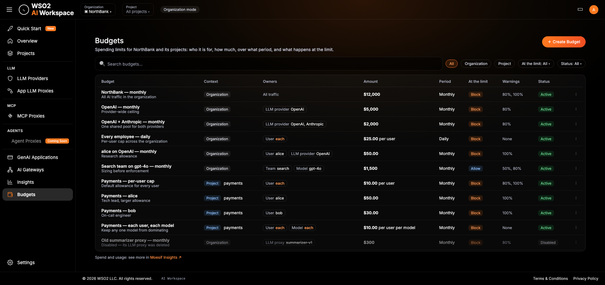
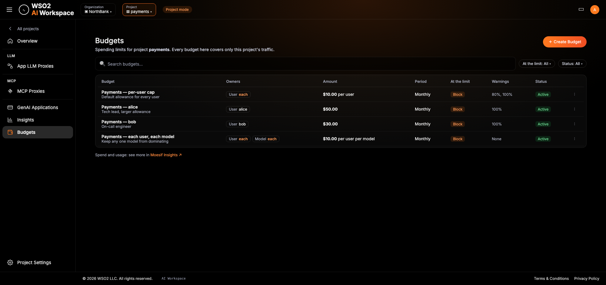
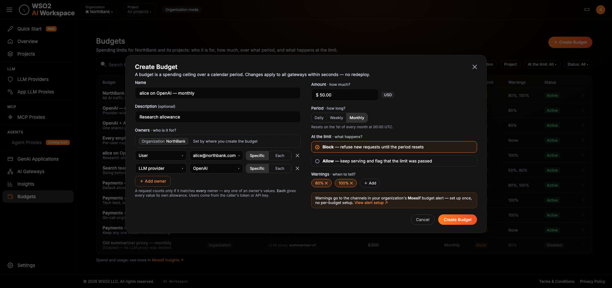
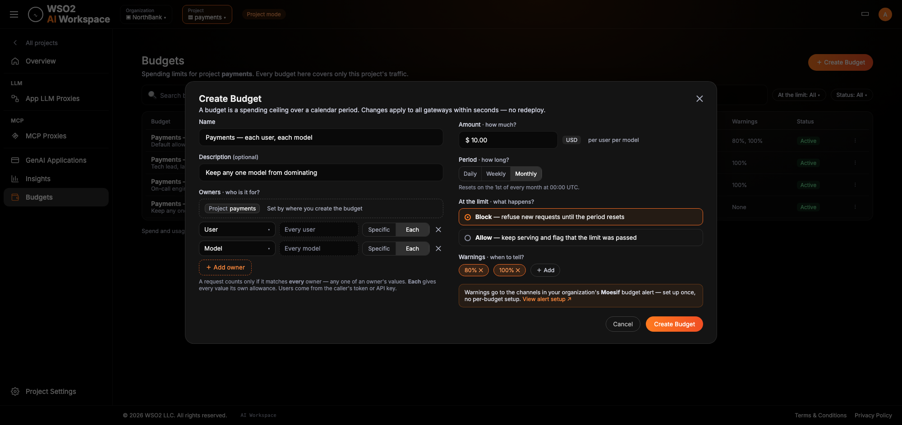
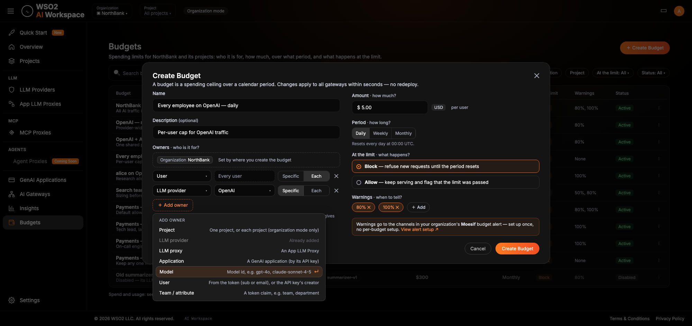
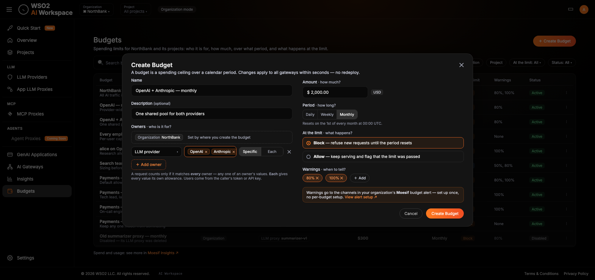
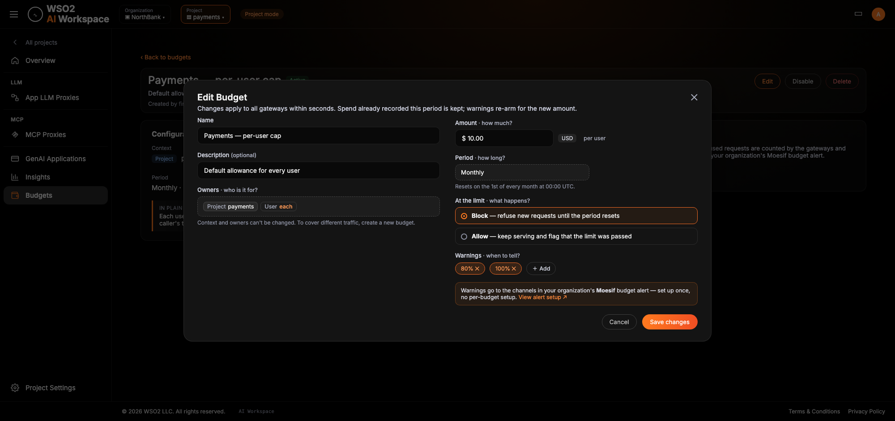
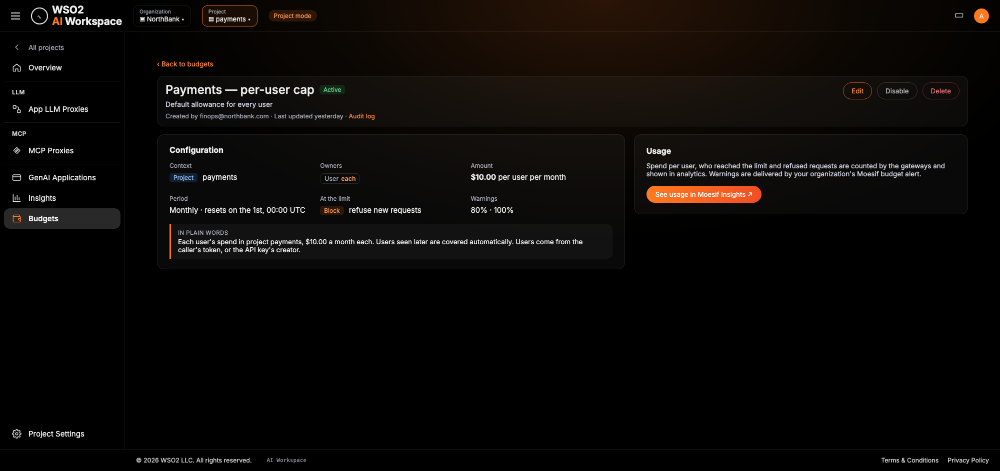

# **UIs**

# 1. Summary

| Portal | Screen / Component | Change | Notes |
| :---- | :---- | :---- | :---- |
| AI Workspace | Sidebar | Modified | New **Budgets** item directly below **Insights**. |
| AI Workspace | Budgets list | New | In **org mode**, all budgets of the organization with their **configuration** — context, owners, amount, period, mode, status; in **project mode**, the budgets created in that project. No spend. |
| AI Workspace | Create Budget dialog | New | One dialog in both modes: name, description, the **first owner** fixed by the mode (the organization or the current project) and **＋ Add owner** rows on the left; amount / period / enforcement / warnings on the right. Revised and redrawn 2026-10-14. |
| AI Workspace | Edit Budget dialog | New | Same dialog; the first owner, the owners and the period are shown read-only with a "fixed after creation" hint; notes when the budget is overridden for some values. |
| AI Workspace | Budget detail (no "each" owner) | New | Configuration card and a Usage card with a "See usage" link to the embedded analytics. |
| AI Workspace | Budget detail (with "each" owners) | New | Same layout; the configuration explains that every value (or combination of values) is counted separately; per-value usage is in analytics only. |
| AI Workspace | Insights page | Modified | The embedded analytics URL comes from the new runtime setting `APIP_AIW_MOESIF_ANALYTICS_URL` instead of being hard-coded; no visible change with the default value. |
| Embedded Moesif analytics | LLM Analytics page | Modified (template) | One new **Budget Usage** card and a **Budget** filter next to the existing API filter. Everything else on the page is unchanged. |
| Embedded Moesif analytics | Alert rule "BUDGET: Threshold crossed" | New (template) | One rule per organization that delivers every budget threshold warning. |

**Budget owners** (decided by the feature owner on 2026-10-14; model owner, most specific wins and multi-value owners added the same day): a budget's first owner is the AI Workspace mode it is created in — the organization in org mode, or the project in project mode. Any number of further owners can be added — project (org mode only), LLM provider, LLM proxy, model, application, token claim — each one or more specific values (any of them matches, and the listed values share one allowance, e.g. LLM provider = OpenAI, Anthropic at $2,000) or **Each**, and a request counts only when it matches all of them. When two budgets have the same context, period and owner types, the **more specific one wins** for its value (e.g. `sub = alice` $50 replaces `sub = each` $10 for alice; provider = OpenAI $500 replaces provider = OpenAI, Anthropic $2,000 for OpenAI traffic); budgets with different owner types or contexts still stack. This replaces the earlier "Who does this budget apply to? / How should the amount be shared? / Which …?" steps.

**Mockups**: the nine screens below were redrawn on 2026-10-14 and live in `mockups/` next to this document (editable sources: `~/Desktop/feature_budgets/mockups-src/`). The 2026-10-08 mockups are kept in the MkDocs site under `docs/assets/mockups/superseded/`.

**The AI Workspace shows budget configuration only** (decided by the feature owner on 2026-10-09). Spend, remaining amount, percentage used, near-limit / exhausted state, per-value figures, refusals and unpriced requests are shown only in the embedded Moesif analytics, where each budget's "See usage" link leads.

# 2. User Flows

**Create a budget**

1. A user holding `ap:budget:manage` selects **Budgets** in the sidebar (below **Insights**), either in org mode or inside a project (project mode).
2. The Budgets list opens. The user selects **＋ Create Budget**.
3. The Create Budget dialog opens over the list. The user enters a name and, optionally, a description.
4. **Applies to**: the first owner is shown as a fixed chip — "{organization} (organization)" in org mode, "{project} (project)" in project mode. It cannot be changed in the dialog.
5. Optionally, the user selects **＋ Add owner** one or more times. For each row the user picks a dimension — Project (org mode only), LLM provider, LLM proxy, Application, Model or Token claim — and then either one or more specific values (searchable multi-select; for a token claim, a claim name and one or more values) or **Each** (for a token claim, a claim name and **Each**). Dimensions already used are disabled; a token claim can be added once per claim name. There is no limit on the number of rows.
7. The user enters the amount (USD), picks Daily / Weekly / Monthly, picks Enforce or Monitor and adjusts the warning thresholds.
8. The user selects **Create Budget**. The dialog closes and the new budget appears in the list. It applies to all gateways within seconds, with no redeploy.

**See a budget's usage**

1. A user holding `ap:budget:read` or `ap:budget:manage` opens **Budgets** and selects a budget (or uses the list footer link).
2. The detail page shows the budget's configuration and a **Usage** card.
3. The user selects **See usage in Moesif Insights ↗**. The embedded analytics opens in a new tab on the **LLM Analytics** page with the **Budget** filter set to the budget (falls back to the analytics home page until the deep-link format is confirmed, §9).
4. The **Budget Usage** card shows the budget's amount, spend this period, % used and refused requests; for a budget with "each" owners it lists one row per value or combination (e.g. per user, or per user and provider).

**Change, disable or delete a budget**

1. A user holding `ap:budget:manage` opens a budget and selects **Edit**, **Disable** (or **Enable** on a disabled budget) or **Delete**.
2. Edit opens the dialog with the current values; name, description, amount, enforcement mode and thresholds are editable; the first owner, the owners and the period are read-only.
3. Disable sets the status to Disabled. Enforcement stops and spend made while disabled is not counted; spend recorded earlier in the period is kept for when the budget is enabled again.
4. Delete removes the budget. Enforcement stops immediately. Past spend remains in Moesif.

**Receive a threshold warning**

1. An administrator applies the "BUDGET: Threshold crossed" alert rule template once in the organization's Moesif and chooses channels (email, Slack, PagerDuty, webhook).
2. When a budget's spend crosses one of its thresholds, the gateway marks the crossing request's analytics event; Moesif's rule fires once for that budget, threshold and value combination and sends the message to the chosen channels. New budgets need no Moesif change.

# 3. Screen: Budgets list

**Purpose**: See the budgets — in org mode every budget in the organization (org- and project-context), in project mode only the budgets created in that project — and how they are configured. Users with manage permission can also start creating a budget here.

**Entry points**: Sidebar item **Budgets**, placed directly below **Insights**, in org mode and in project mode. The **‹ Back to budgets** link on a budget detail page also leads here.

**Permissions**: Visible to users holding `ap:budget:read` or `ap:budget:manage`. By default `ap:budget:manage` maps to the organization administrator role (`ap_admin`) and `ap:budget:read` to the operator role (`ap_operator`). Whether the viewer role (`ap_viewer`) also gets `ap:budget:read` is open (§9). For a user without either scope the API returns 403; whether the sidebar item is hidden for that user is open (§9).

*Org mode: every budget of the organization, with its context. Override relationships are shown on the detail page, not in the list.*

*Project mode: only the project's budgets, with no Context column or context chips.*

**Elements**

| Element | Type | Behaviour | Validation |
| :---- | :---- | :---- | :---- |
| Page title "Budgets" and subtitle | display | Org mode: "Spending limits for {organization} and its projects. Add owners to narrow a budget to a user, team, provider, proxy, application or model." Project mode: "Spending limits for project {project}. Every budget here covers only this project's traffic." | — |
| Mode indicator in the top bar | display | "Organization mode" or "Project mode" next to the organization and project selectors. | — |
| **＋ Create Budget** | action | Opens the Create Budget dialog (§4). Shown only to users holding `ap:budget:manage`. | — |
| Search "Search budgets..." | input | Filters the list by text (API `query`). | — |
| Context chips (org mode only): All, Organization, Project | filter | Single-select filter on where budgets were created (API `contextType`). "All" by default. In project mode the list is always filtered to the current project (API `project`) and the chips are hidden. The earlier owner-type chips (All scopes, Organization, Project, LLM Provider, …) are superseded. | Only the listed values; the API rejects others with 400. |
| "Status: All ▾" | filter | Filters by status (API `status`: `ACTIVE` / `DISABLED`). The mockup shows "All" as the default. | Only `ACTIVE` / `DISABLED`. |
| Column **Budget** | display | Display name (bold) and description (muted). For a budget disabled because its owner was deleted, the second line reads "Disabled — its LLM proxy was deleted" (wording follows the owner type) and the row is greyed out. | — |
| Column **Context** (org mode only) | display | "Organization" or the project's display name. | — |
| Column **Owners** | display | The appended owners as chips, each "{dimension label} {value}" with **each** highlighted — e.g. `User (sub) each`, `LLM provider OpenAI`, `LLM provider OpenAI, Anthropic` (a value list), `Model gpt-4o`, `team search`. A budget with no appended owner reads "All traffic". A deleted owner's value is struck through. (Earlier text form, still valid for screen readers: display names for specific values (e.g. "OpenAI", "claude-pilot"), `claim = value` for a specific claim value (e.g. `team = search`), and "each user" / "each provider" / "each app" (and similar) for **Each** owners — e.g. "Search · each user · OpenAI". A budget with no added owner shows only its context ("Whole organization", or the project name). A deleted owner's name is struck through.) | — |
| Column **Amount** | display | Amount and period, e.g. "$12,000 / month". Budgets with **Each** owners add the per-value noun, e.g. "$25.00 per user / day", "$10 per user per provider / month". | — |
| Column **Mode** | display | "Enforce" or "Monitor" tag. | — |
| Column **Status** | display | "Active" or "Disabled" in the mockup (see §9 on the "Monitor" label). | — |
| Row menu **⋮** | action | Row-level actions; content not specified in the mockup (§9). Hidden for users holding only `ap:budget:read`. | — |
| Row click | action | Opens the budget detail page (§5 or §6). | — |
| Footer | display + link | Org mode: \"Spend and usage: see more in **Moesif Insights ↗**". Project mode: "Spend and usage: see more in **Moesif Insights ↗**". The link opens the embedded analytics at `APIP_AIW_MOESIF_ANALYTICS_URL` in a new tab. | — |

No spend, meter, percentage or near-limit / exhausted indicator appears anywhere on the list.

**States**

| State | Presentation |
| :---- | :---- |
| Loading | The page header and filters render; the table area shows a loading indicator until the list response arrives. The component is not specified. |
| Empty (no data yet) | No budgets exist in the organization: the table is replaced by an empty-state message and, for `ap:budget:manage` holders, the **＋ Create Budget** call to action. Wording not yet defined (§9). When filters or search exclude every budget, a "no matching budgets" variant is shown; wording not yet defined. |
| Populated | Table as in the mockup, paginated (API `limit` / `offset`, `limit` 1–100). |
| Error | Generic, user-facing message that the budgets could not be loaded, with a retry action. No status codes, error codes, stack traces or internal identifiers. Wording not yet defined (§9). |
| Read-only / no permission | `ap:budget:read` without `ap:budget:manage`: list, filters and the Moesif link are shown; **＋ Create Budget** and the row **⋮** menu are hidden, not disabled. |

**Messages**

| Trigger | Type | Text |
| :---- | :---- | :---- |
| Page footer (always) | Info | "… Spend and usage: see more in Moesif Insights ↗" (see the Footer row) |
| Budget created (dialog closed) | Success | Not yet defined (§9). |
| List failed to load | Error | Not yet defined; must stay generic (§9). |

# 4. Screen: Create / Edit Budget dialog

**Purpose**: Define a budget — a monetary amount for a set of owners over one UTC calendar period, with an enforcement mode and warning thresholds. The same dialog, with fields locked, edits a budget.

**Entry points**: **＋ Create Budget** on the Budgets list (create); **Edit** on a budget detail page (edit). An edit entry in the list row **⋮** menu is not confirmed (§9).

**Permissions**: Only users holding `ap:budget:manage`. The entry points are hidden for everyone else; the API also enforces the scope (403 without it).

**Layout (revised 2026-10-14)**: Title "Create Budget" with a close (✕) control and the subtitle "A budget is a spending ceiling for one or more owners over a calendar period. Changes apply to all gateways within seconds — no redeploy." Two columns:

* Left: **Name**, **Description (optional)**, then **Applies to**: the first owner as a fixed chip, the added owner rows and **＋ Add owner** (§4.1–§4.2).
* Right: **Amount**, **Period**, **When the budget is used up**, **Warn at**, and the Moesif note.
* Footer: **Cancel** and **Create Budget**.

Mockups: §4.4.

**Elements (common to every owner type)**

| Element | Type | Behaviour | Validation |
| :---- | :---- | :---- | :---- |
| Name | input | Budget display name. | Required; at most 255 characters (server: 400 `BUDGET_INVALID`). |
| Description (optional) | input | Shown under the name on the list and detail pages. | At most 1,023 characters (server: 400 `BUDGET_INVALID`). |
| Applies to — first owner | fixed chip | "Organization {organization}" in org mode; "Project {project}" in project mode, with "Set by where you create the budget" and a lock icon. Not removable. | Set by the mode. |
| Added owner rows | row builder | See §4.2. | Each dimension once; token claim once per claim name; no limit on rows (server: 400 `BUDGET_OWNER_DUPLICATE`). |
| ＋ Add owner | action | Adds an empty owner row. | — |
| Owner help line | display | "A request counts toward this budget only if it matches **every** owner. **Each** gives every value its own allowance." | — |
| Amount | input with "USD" tag | Monetary amount with a "$" prefix. Only USD. With **Each** owners a suffix names the unit, e.g. "per user", "per user per model". | Required; greater than 0; at most 12 integer and 6 fractional digits (server: 400 `BUDGET_INVALID`). |
| Period | segmented control | Daily / Weekly / Monthly. Help line: "Resets every day at 00:00 UTC." / "Resets every Monday at 00:00 UTC." / "Resets on the 1st of every month at 00:00 UTC.", followed by "Spend before today is not counted." | One of the three. |
| When the budget is used up | radio | **Enforce** — "refuse new requests until the period resets" (default); **Monitor** — "track and warn only, never block". | One of the two. |
| Warn at | chips | Removable threshold chips (default 50 %, 80 %, 100 %) and **＋ Add**. | At most 5; each 1–100; no duplicates (server: 400 `BUDGET_INVALID`). |
| Moesif note | display + link | "Warnings go to the channels in your organization's **Moesif** budget alert (Slack, email, PagerDuty, webhook) — set up once, no per-budget setup." with **View alert setup ↗**, linking to the alert-setup guide. | — |
| Cancel / ✕ | action | Closes without saving. | — |
| Create Budget | action | Submits. On success the dialog closes and the list refreshes; on a server error the dialog stays open. | — |

Whether the dialog checks these rules on the client before submitting, or relies on the server response, is not specified (§9).

## 4.1 First owner (context)

| Mode | Chip | Help line |
| :---- | :---- | :---- |
| Org mode | "Organization {organization name}" | "Organization budgets cover AI traffic across the organization. Add owners to narrow it — e.g. a project, a provider, a model or each user." |
| Project mode | "Project {project name}" | "Project budgets cover traffic through LLM proxies that belong to this project. Add owners to narrow it — e.g. a provider, a model or each user." Project owners are not offered in project mode. |

A budget with no added owner covers the whole context: in org mode every AI request of the organization; in project mode every request through the project's LLM proxies.

## 4.2 Added owner rows

Each row: **Dimension** select · **Values** control · **Specific | Each** segmented toggle · remove (✕). With **Specific** selected the values control is a **multi-select**: every chosen value shows as a chip with its own ✕, and the dropdown ("Add…") adds more. With **Each** selected the values control reads "Every value" ("Every model", …) and is disabled. **＋ Add owner** opens a menu of dimensions, each with a one-line description; dimensions already added are disabled and marked "Already added" (Project appears only in org mode). The value control depends on the dimension:

| Dimension | Values control | Specific values | Each | Help line |
| :---- | :---- | :---- | :---- | :---- |
| Project (org mode only) | Searchable list of the organization's projects (existing projects API) with an **Each project** option | One or more projects | Every project, including projects created later | "Project owners match traffic through LLM proxies of that project." |
| LLM provider | Searchable list ("Search LLM providers…"; rows show the provider name and "Template: {template}") with **Each provider** | One or more providers (e.g. OpenAI and Anthropic, one shared allowance) | Every provider, including providers added later | "A provider owner matches all traffic to that provider — direct calls and calls through any LLM proxy that uses it." |
| LLM proxy | Searchable list ("Search App LLM Proxies…"; rows show the proxy name and "Project: {project} · {provider}"; in project mode only that project's proxies) with **Each proxy** | One or more proxies | Every proxy, including proxies created later | "A proxy owner matches only traffic through that App LLM Proxy." |
| Model (delivery phase 2) | Free-text model ids (one chip each) with suggestions from the model catalog (e.g. `gpt-4o`, `claude-sonnet-4-5`), with an **Each model** option | One or more models | Every model, including models first used later | "Matches the model id the gateway sends to the provider, after any proxy model rewrite — the id used for pricing. Requests whose model can't be determined don't count." |
| Application (delivery phase 2) | Searchable list ("Search applications…"; rows show "Project: {project}"; in project mode only that project's applications) with **Each application** | One or more applications | Every application, including applications created later | "Applications are your GenAI Applications. Their traffic is identified by the application's API key." |
| Token claim (delivery phase 2) | **Claim name** input (e.g. `team`, `sub`, `cost_centre`) and **Claim values** chip input with an **Each** toggle | One or more claim values, e.g. `team` = search, ranking | Every value, e.g. every user via `sub` | "Uses a claim from the caller's verified token. Applies to token-authenticated (JWT) traffic only. For per-user budgets use the claim that identifies the user (often `sub`, `email` or `preferred_username`)." |

Rules shown in the dialog:

* A request matches an owner when its value is **any** of the listed values; listed values never split the allowance (only **Each** does). At least one value is required, no duplicates; the order doesn't matter (the same set in any order is the same budget, server: 409 `BUDGET_ALREADY_EXISTS`).
* A dimension already used in another row is disabled in the select (add more values in that row instead); a token claim can be added again with a different claim name (e.g. `team = search` and `sub` = Each).
* Model values are free text (1–255 characters, exact and case-sensitive); suggestions come from the model catalog, but any id is accepted because the catalog can lag new models (server: 400 `BUDGET_INVALID_OWNER`).
* Claim names are data, not a product-defined list; pattern `^[A-Za-z0-9_.:-]{1,255}$` (server: 400 `BUDGET_INVALID_OWNER`).
* There is no limit on rows or on values per row in v1 (a cap may be added later, §9).

## 4.3 Plain-words sentence and examples

The dialog has no summary box (removed 2026-10-14). The sentence below is shown only on the budget detail page (**In plain words**, §5), built from whole sentence templates (not concatenated fragments):

| Mode | Owners | Amount / period | Summary |
| :---- | :---- | :---- | :---- |
| Org | — | $12,000 / month | "All AI traffic in {organization} spends from $12,000.00 a month." |
| Org | `sub` = Each | $25 / day | "Each user gets $25.00 a day." |
| Org | LLM provider = OpenAI, Anthropic | $2,000 / month | "Spend on OpenAI or Anthropic across {organization}: $2,000.00 per month (one shared pool)." |
| Org | `sub` = alice@acme.com · LLM provider = OpenAI | $50 / month | "alice@acme.com gets $50.00 a month on OpenAI." |
| Org | Project = Each | $2,000 / month | "Each project gets $2,000.00 a month." |
| Project (search) | `sub` = Each · LLM provider = Each | $10 / month | "Each user gets $10.00 a month per LLM provider in project search." |
| Project (search) | `team` = search · LLM proxy = chat-proxy | $1,500 / month | "Everyone with team = search spends from $1,500.00 a month through chat-proxy in project search." |
| Org | `sub` = Each · Model = gpt-4o | $5 / month | "Each user gets $5.00 a month on gpt-4o." |
| Project (payments) | `sub` = Each · Model = Each | $10 / month | "Each user, on each model, in project payments: $10.00 per month each. Users and models seen later are covered automatically." |

## 4.4 Mockups

| Mockup | Shows |
| :---- | :---- |
|  | Org mode: `sub = alice` + LLM provider = OpenAI, $50 / month. |
|  | Project mode: `sub` = Each + Model = Each, $10 per user per model / month. |
|  | The **＋ Add owner** menu: LLM provider already added (disabled); Model highlighted. |
|  | Org mode: LLM provider = OpenAI and Anthropic (multi-select chips), $2,000 / month, one shared pool. |

The 2026-10-08 owner-type mockups ("1. Who does this budget apply to?" …) are superseded.

## 4.5 Overrides are not shown in the UI

The most-specific-wins rule (FR-003a) is applied by the gateways and returned by the API (`overrides`, `overriddenBy`, the `BUDGET_OVERRIDES_OTHER` warning), but the AI Workspace shows nothing about it: no warning in the dialog, no badges in the list and no sections on the detail page (feature owner, 2026-10-14).

## 4.8 Edit mode

Required behaviour:

| Element | Edit-mode presentation |
| :---- | :---- |
| Title / primary button | "Edit Budget" / "Save changes"; subtitle "Changes apply to all gateways within seconds. Spend already recorded this period is kept; warnings re-arm for the new amount." |
| Name, Description, Amount, Warn at, When the budget is used up | Editable, pre-filled with the current values. |
| Enabled state | Editable (the Disable / Enable action on the detail page performs the same change). |
| First owner chip, owner rows, Period | Shown **read-only** as chips with a "🔒 fixed after creation" hint and the line "Context and owners can't be changed. To cover different traffic, create a new budget." (no ＋ Add owner, no ✕). Changing any of them needs a new budget; the API rejects an attempt with 400 `BUDGET_IMMUTABLE_FIELD`. |
| Amount change | Never changes recorded spend; every warning threshold is re-armed, and if spend is already above several, only the highest is notified. Whether the dialog explains this is not specified (§9). |
| Switching Monitor → Enforce | Spend already recorded this period counts; enforcement starts immediately. |

**States (dialog)**

| State | Presentation |
| :---- | :---- |
| Loading | Owner pickers load their lists from the existing APIs when opened; a loading indicator inside the list is expected (component not specified). |
| Empty (no data yet) | An owner picker with no items (e.g. no LLM proxies yet) shows an empty list; wording not yet defined (§9). |
| Populated | As in the mockups. |
| Error | Submission failure keeps the dialog open with the entered values and shows a generic message; field problems inline. No stack traces or internal identifiers. |
| Read-only / no permission | Not reachable without `ap:budget:manage`; the entry points are hidden. |

**Messages**

| Trigger | Type | Text |
| :---- | :---- | :---- |
| Budget created / updated | Success | Not yet defined (§9). |
| 400 `BUDGET_INVALID` / `BUDGET_INVALID_OWNER` / `BUDGET_OWNER_DUPLICATE` / `BUDGET_OWNER_NOT_ALLOWED` | Inline / dialog error | Not yet defined; must not reveal internal detail. |
| 404 `BUDGET_OWNER_NOT_FOUND` (selected project / provider / proxy / application no longer exists) | Dialog error | Not yet defined. |
| 409 `BUDGET_ALREADY_EXISTS` (the same owners already have a budget for this period) | Dialog error | Not yet defined; should tell the user these owners already have a budget for this period. |
| 400 `BUDGET_IMMUTABLE_FIELD` (edit) | Dialog error | Not yet defined; should not occur when the locked fields are read-only. |

# 5. Screen: Budget detail (no "each" owner)

**Purpose**: See one budget's configuration, manage it, and jump to its usage in analytics.

**Entry points**: Row click on the Budgets list.

**Permissions**: `ap:budget:read` or `ap:budget:manage`. **Edit**, **Disable / Enable** and **Delete** are shown only with `ap:budget:manage`.

The layout is the one drawn for a budget with an **Each** owner in §6; a budget without one has the same cards, and its plain-words line describes the shared pool.

**Elements**

| Element | Type | Behaviour | Validation |
| :---- | :---- | :---- | :---- |
| ‹ Back to budgets | action | Returns to the list. | — |
| Header: display name and status tag | display | e.g. "Search team — monthly" with "Active". | — |
| Description | display | e.g. "Chargeback for the search squad". | — |
| Audit line | display | "Created by {user} · Last updated {relative time}". | — |
| Edit | action | Opens the Edit dialog (§4.8). | — |
| Disable / Enable | action | Disable sets the status to Disabled; on a disabled budget the button reads **Enable**. | — |
| Delete | action | Deletes the budget. A confirmation step is not shown in the mockups (§9). | — |
| Configuration card: **Context** and **Owners** | display | The context tag ("Organization" or "Project {name}") and every owner as a chip, e.g. `team search` · `LLM provider OpenAI` · `Model gpt-4o`; **Each** owners read e.g. `User (sub) each`. | — |
| Configuration card: **In plain words** | display | The summary sentence of §4.3. | — |
| Configuration card: **Amount** | display | e.g. "$1,500.00 per month". | — |
| Configuration card: **Period** | display | e.g. "Monthly · resets on the 1st, 00:00 UTC". | — |
| Configuration card: **When used up** | display | "Enforce" tag + "refuse new requests", or the Monitor equivalent. | — |
| Configuration card: **Warn at** | display | e.g. "50 · 80 · 100%". | — |
| Usage card | display | "Spend against this budget is counted by the gateways and shown in analytics. Warnings at each threshold are delivered by your organization's Moesif budget alert." | — |
| **See usage in Moesif Insights ↗** | link | Opens the LLM Analytics page under `APIP_AIW_MOESIF_ANALYTICS_URL` in a new tab, with the Budget filter set to this budget (`metadata.budget_id` = the budget's id) where the deep-link format is supported; otherwise the analytics base URL. | — |

**States**

| State | Presentation |
| :---- | :---- |
| Loading | Header and cards show a loading indicator until the budget response arrives (component not specified). |
| Empty (no data yet) | N/A — the page shows configuration only; a just-created budget looks the same as any other. |
| Populated | As in the mockup. |
| Error | Generic message that the budget could not be loaded. A budget that does not exist or belongs to another organization gives the same 404 and the same "not found" presentation. Wording not yet defined. |
| Read-only / no permission | `ap:budget:read` only: Edit, Disable / Enable and Delete are hidden; everything else is shown. |
| Disabled | Status "Disabled". Also when any one resource in an owner's value list is deleted. When `statusReason = OWNER_DELETED`, the page reads "Disabled — its project / LLM provider / LLM proxy / application was deleted" (naming the deleted owner) and offers Delete to managers. Not drawn in the detail mockups. |

**Messages**

| Trigger | Type | Text |
| :---- | :---- | :---- |
| Budget disabled because its owner was deleted | Info | "Disabled — its {project / LLM provider / LLM proxy / application} was deleted" |
| Budget disabled / enabled / deleted | Success | Not yet defined (§9). |

# 6. Screen: Budget detail (with "each" owners)

**Purpose**: The same as §5 for a budget with one or more **Each** owners, which gives every value (or combination of values) its own allowance — every user, application, project, LLM provider or LLM proxy. The page shows the definition only; per-value spend, who reached the limit and refused requests are in analytics.

**Entry points**: Row click on a budget with **Each** owners in the Budgets list.

**Permissions**: As §5. No claim values (for example users' email addresses) are shown on this page.

*Project mode: \"Payments — per-user cap\" ($10 per user per month).*

**Elements**

| Element | Type | Behaviour | Validation |
| :---- | :---- | :---- | :---- |
| ‹ Back to budgets, header, description, audit line, Edit / Disable / Delete | display / action | As on §5. | — |
| Configuration card | display | **Context** `Project payments`; **Owners** `User (sub) each`; **Amount** "$10.00 per user per month"; **Period** "Monthly · resets on the 1st, 00:00 UTC"; **When used up** "Enforce · refuse new requests"; **Warn at** "80 · 100%"; **In plain words** "Each user's spend in project payments, $10.00 a month each. Users seen later are covered automatically. Token-authenticated traffic only." | — |
| Info box | display | "Every user (each value of the sub claim) gets their own $25.00 a day and is counted separately; new users are covered automatically. Applies to token-authenticated traffic only." With several **Each** owners: "Every combination of user and LLM provider gets its own $10.00 a month." The wording for project, LLM provider, LLM proxy and application owners is not drawn (§9). | — |
| Usage card | display | "Spend per user, who reached the limit and refused requests are counted by the gateways and shown in analytics. Warnings are delivered by your organization's Moesif budget alert." | — |
| **See usage in Moesif Insights ↗** | link | As on §5; with the Budget filter set, the Budget Usage card lists one row per value (§7.2). | — |

**States**: as §5. There is no per-value table, tile, search or pagination on this page.

**Messages**: as §5.

# 7. Embedded analytics (Moesif)

These are templates applied in the organization's embedded Moesif analytics, delivered with the user guide; they are not AI Workspace code. Creating or changing a budget needs no Moesif change. Every figure comes from fields that the gateway publishes on each AI request event under `metadata` (`budget_id`, `budget_name`, `budget_owners`, `budget_owner_values`, `budget_period`, `budget_amount`, `budget_spend`, `budget_percent_used`, `budget_refused`, `budget_threshold_crossed`, `llm_cost_status`), plus the existing cost field `metadata.aiMetadata.llmCost`. The card and filter need the delivery-phase-2 analytics fields.

## 7.1 Screen: LLM Analytics page — Budget Usage card

**Purpose**: See, for every budget, how much has been spent in the current period against its amount, how much of it is used, and how many requests it refused.

**Entry points**: The **LLM** item under Analytics in the embedded Moesif analytics; the Budgets list footer link and each budget's "See usage" link in the AI Workspace.

**Permissions**: Whoever can open the organization's embedded analytics today; no new permission is introduced.

![][image11]

**Elements**

| Element | Type | Behaviour | Validation |
| :---- | :---- | :---- | :---- |
| Existing page content (API filter, time range, KPI tiles Unique Consumers / Total Requests / Average Error Rate / Token Usage / Estimated Cost, Cost Trend per Provider) | display | Unchanged. | — |
| **Budget** filter (new, next to the API filter) | filter | "Search or enter a value"; filters the whole page's events on `metadata.budget_id`, values labelled by `metadata.budget_name`. | — |
| **Budget Usage** card (new) | table | One row per budget, grouped by `metadata.budget_name` and `metadata.budget_period`; the card subtitle shows the query. Paginated (Previous / Page n of m / Next). Column filters under each heading. | — |
| Column **Budget Name** | display | `metadata.budget_name`, e.g. "Search team — monthly". | — |
| Column **Amount** | display | `max(metadata.budget_amount)`, e.g. 1,500.00. | — |
| Column **Spend This Period** | display | `max(metadata.budget_spend)`, e.g. 1,503.20. | — |
| Column **% Used** | display | `max(metadata.budget_percent_used)`; can exceed 100 (e.g. 100.2 on an enforce budget after in-flight overshoot, 128.0 on a monitor budget). | — |
| Column **Refused** | display | Count of events where `metadata.budget_refused = true`, e.g. 318. | — |

**States**

| State | Presentation |
| :---- | :---- |
| Loading | Moesif's standard card loading. |
| Empty (no data yet) | No budgeted traffic in the selected time range: empty table. A budget with no traffic yet does not appear. |
| Populated | As in the mockup. |
| Error | Moesif's standard card error. |
| Read-only / no permission | Governed by the existing analytics access. |

## 7.2 Screen: LLM Analytics page — Budget filter set to a budget with "each" owners

**Purpose**: See per-value usage of a budget with **Each** owners, e.g. each user's spend against "Every employee — daily".

**Entry points**: Setting the Budget filter on the LLM Analytics page, or the "See usage" link of a budget with **Each** owners.

**Permissions**: As §7.1.

![][image12]

**Elements**

| Element | Type | Behaviour | Validation |
| :---- | :---- | :---- | :---- |
| Budget filter | filter | Set to the budget, e.g. "Every employee — daily"; highlighted. | — |
| Card subtitle | display | e.g. "Budget filter = Every employee — daily ($25 per user per day) · group by metadata.budget_owner_values". | — |
| Column **User** | display | `metadata.budget_owner_values` — the caller's own values for the **Each** owners, e.g. `sub=alice@acme.com`, or `provider=OpenAI; sub=alice@acme.com` with two **Each** owners. | — |
| Column **Spend Today** | display | That value's spend in the current period, e.g. 25.00. | — |
| Column **% Used** | display | e.g. 100.0, 87.2. | — |
| Column **Refused** | display | Refused requests for that value, e.g. 41. | — |
| Pagination | action | e.g. "Page 1 of 428". | — |

**States**: as §7.1.

## 7.3 Screen: Alert rule "BUDGET: Threshold crossed"

**Purpose**: Deliver every budget threshold warning in the organization through one rule.

**Entry points**: **Alerts** under Alerting in the embedded Moesif analytics; the dialog's **View alert setup ↗** link leads to the setup guide.

**Permissions**: Whoever can manage alert rules in the organization's Moesif today.

![][image13]

**Elements**

| Element | Type | Behaviour | Validation |
| :---- | :---- | :---- | :---- |
| Events Where | condition | `metadata.budget_threshold_crossed` **exists** — present only on the one event, across all gateways, whose charge crossed a threshold. | — |
| Group By | grouping | `metadata.budget_name`, `metadata.budget_threshold_crossed`, `metadata.budget_owner_values`. | — |
| Metrics | display | Event Count, with a preview chart (per 15 minutes, last 7 days). | — |
| Rule name | display | "BUDGET: Threshold crossed". | — |
| For / Alert when | condition | For all events; count is greater than 0 over the last 15 minutes. | — |
| Evaluation Period & Frequency | setting | 15 min, evaluated every minute. Static alert, threshold > 0. | — |
| Send To | setting | Channels, e.g. an email recipient (FinOps) and Slack; **New Channel**. | — |
| Custom Message | setting | "Budget {{metadata.budget_name}} crossed {{metadata.budget_threshold_crossed}}% — {{metadata.budget_spend}} of {{metadata.budget_amount}} ({{metadata.budget_period}})." | — |
| Note | display | "One rule covers every budget and threshold. Optional: duplicate with a Where on metadata.budget_owners to route a team's budgets to its own channel." | — |
| Back / Save | action | Moesif's editor actions. | — |

**States**: Moesif's standard rule-editor states.

# 8. Cross-cutting UI Concerns

* **Responsiveness**: The mockups are drawn at desktop width only (2000 × 943). Narrow-viewport behaviour of the budgets table and the two-column dialog is not specified (§9).
* **Accessibility**: Status and mode are text labels, not colour alone. Keyboard navigation of the owner rows (dimension select, value list, Each toggle, remove), segmented controls, radio groups, threshold chips and searchable pickers, and accessible names for the ✕ / ⋮ icon buttons, are not yet specified (§9).
* **Internationalization**: New strings are the labels, help lines and messages quoted here. Whether the AI Workspace externalises them to a resource bundle is not specified (§9). Sentences with values (the §4.3 summaries, e.g. "Each user gets {amount} a month per LLM provider in project {project}.") should be whole templates with placeholders, not concatenated fragments. Amounts are USD only; times and periods are UTC.
* **Output encoding**: User-supplied values rendered by the AI Workspace screens are the budget display name, description, claim names and specific claim values entered as owners, owner display names and the "Created by" user. They must be rendered through React's default JSX text interpolation (never `dangerouslySetInnerHTML`). Values placed in link URLs, such as the budget id in the Moesif deep link, must be encoded with `encodeURIComponent` (`.claude/rules/js-output-encoding-xss.md`). Per-value claim values taken from callers' tokens appear only in Moesif (§7.2), not in the AI Workspace.
* **Analytics links**: Every "Moesif ↗" link (list footer, "See usage in Moesif Insights", dialog "View alert setup") is built from `APIP_AIW_MOESIF_ANALYTICS_URL` (default `https://www.moesif.com/wrap/basic`, the URL the Insights page used before), not a hard-coded URL.

# 9. Open UI Questions

| Question | Owner | Status |
| :---- | :---- | :---- |
| Status labels: mode and status are separate — a Mode column (Enforce / Monitor) and a Status column (Active / Disabled). | Feature owner | Resolved |
| Create-dialog mockups were re-rendered over the configuration-only budget list. | Feature owner | Resolved |
| Link text: the requirement says "See usage in Insights / Moesif"; the detail mockups read "See usage in Moesif Insights ↗". Which wording is final? | Feature owner | Open |
| LLM Analytics page path under `APIP_AIW_MOESIF_ANALYTICS_URL` and the Budget filter deep-link query format; until confirmed, links open the base URL. Where does **View alert setup ↗** point? | Analytics team | Open |
| What do the analytics links do when the organization has no Moesif configured (hide, or show a setup hint)? | Feature owner | Open |
| Budget Usage card and the page time range: rows are `max()` values grouped by budget and period. With "This Month" selected, does a daily budget show one row per day? Is the card meant to follow the page time range or always show the current period? | Analytics team | Open |
| Column headings of the per-value card rows for project, LLM provider, LLM proxy and application **Each** owners and for combinations (the mockup covers only "User" for a `sub` budget), and the per-value info-box wording for those types on the AI Workspace detail page. | Feature owner | Open |
| The list, Create dialog and detail mockups predate the 2026-10-14 owner model. Redraw them. | Feature owner | Resolved — redrawn 2026-10-14 (§3–§6), including model owners and overrides. |
| Should owner rows, or values per row, be capped (e.g. 3 owners)? No limit in v1. | Architecture and product leads | Open |
| Value lists in summaries: "OpenAI or Anthropic" for two values; how are three or more shown ("OpenAI, Anthropic or Gemini", or "3 providers")? | Feature owner | Open |
| When one resource in a value list is deleted, the budget is disabled (`OWNER_DELETED`). Should the platform drop the value and keep the budget active instead? | Product leads | Open |
| Should a specific-value budget override a broader **Each** budget for that value (most specific wins)? | Product leads | Resolved 2026-10-14 — yes, within the same context, period and owner types (§4.5). |
| There is no mockup for the Edit Budget dialog. | Feature owner | Resolved — drawn 2026-10-14 (§4.8). |
| What does the row **⋮** menu on the Budgets list contain (Edit, Disable / Enable, Delete)? | Feature owner | Open |
| Delete confirmation: is a confirmation dialog shown, and what does it say (past spend stays in Moesif)? | Feature owner | Open |
| Wording for the empty, no-match, loading, error and success states on every AI Workspace screen. None appear in the mockups. | Feature owner | Open |
| Does `ap_viewer` get `ap:budget:read`? Is the sidebar **Budgets** item hidden for users without either budget scope, or shown with an access message? | Product leads | Open |
| Does the dialog validate amount, thresholds, name length and claim-name pattern on the client, or rely on the server's 400 response only? | Feature owner | Open |
| Does the Edit dialog warn that changing the amount re-arms warning thresholds, and that lowering it below current spend refuses requests immediately in Enforce mode? | Feature owner | Open |
| Should the UI warn when the organization has budgets but some connected gateways do not enforce them (older gateways, or budgets disabled)? | Feature owner | Open |
| Per-value claim values (often email addresses) are shown to everyone who can open the organization's analytics. Is masking or a narrower audience required? | Security / product leads | Open |
| Responsive layout and keyboard / screen-reader behaviour for the new screens. | Feature owner | Open |
| Are the new strings externalised to a resource bundle in the AI Workspace? | Feature owner | Open |

<!-- [image11]: <path-or-data-uri> -->
<!-- [image12]: <path-or-data-uri> -->
<!-- [image13]: <path-or-data-uri> -->
